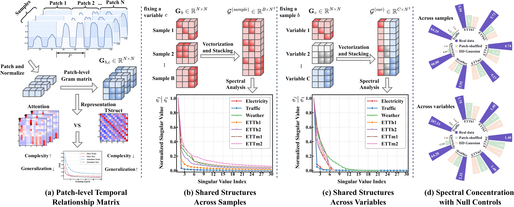
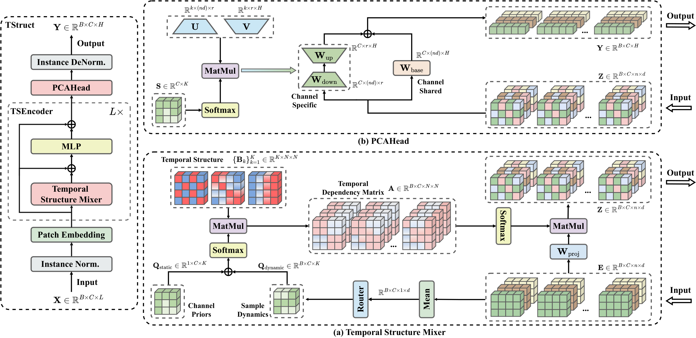
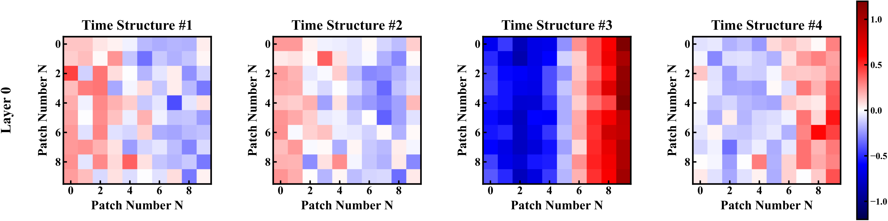
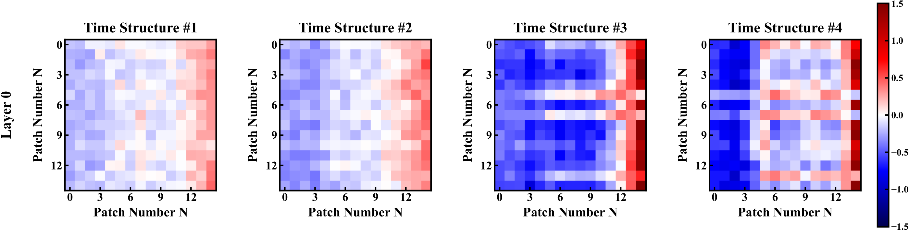
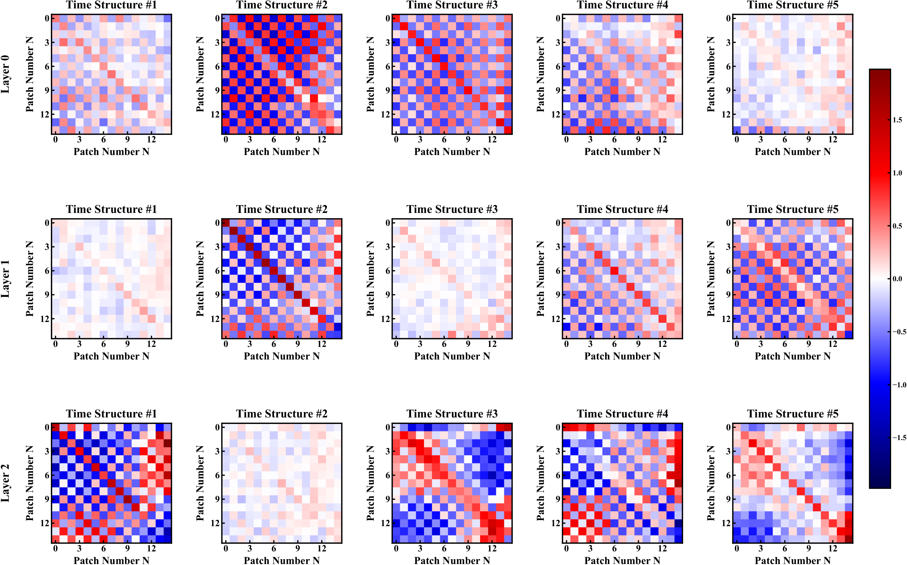
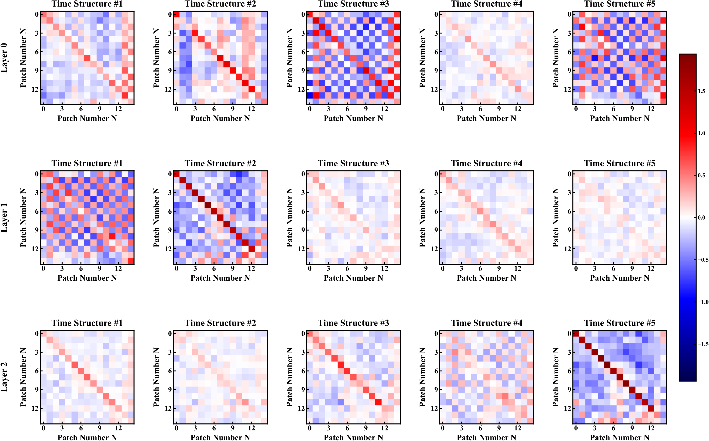
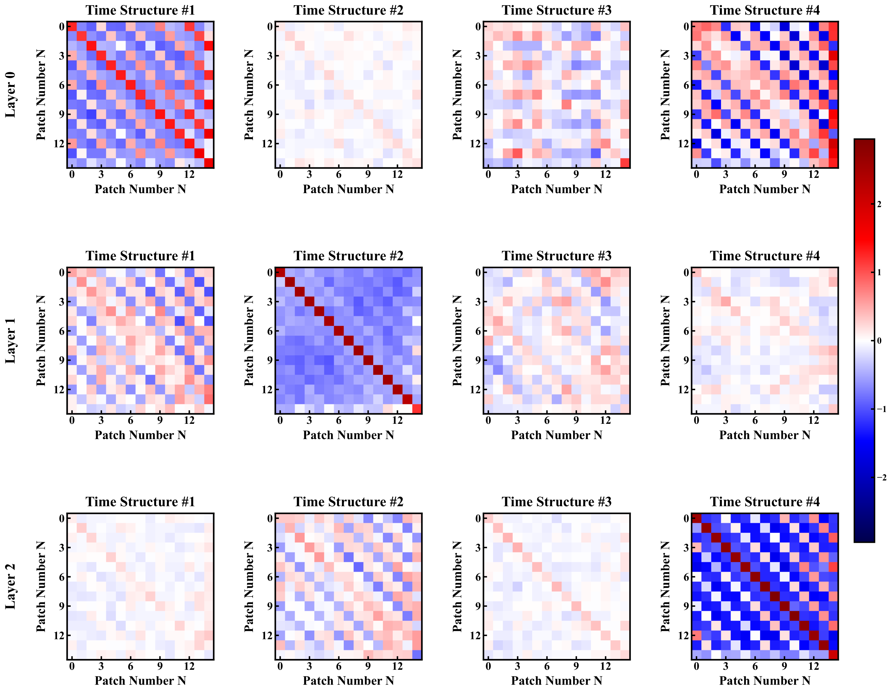
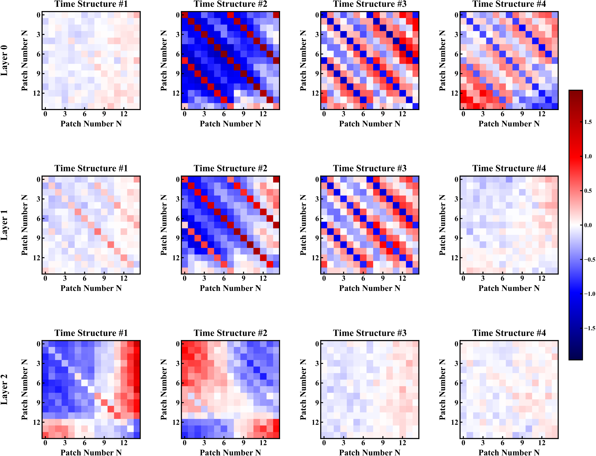
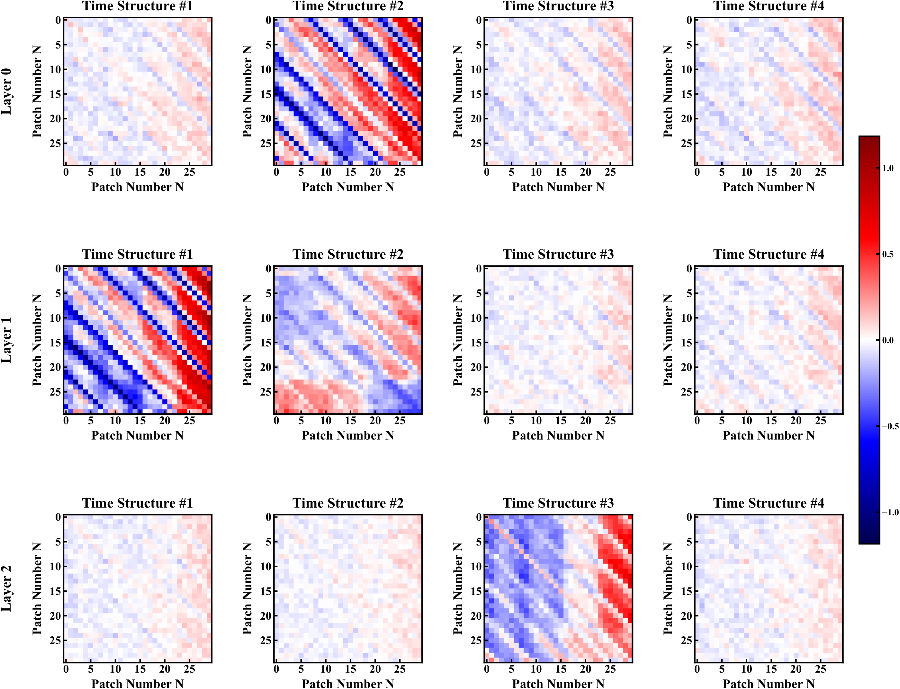
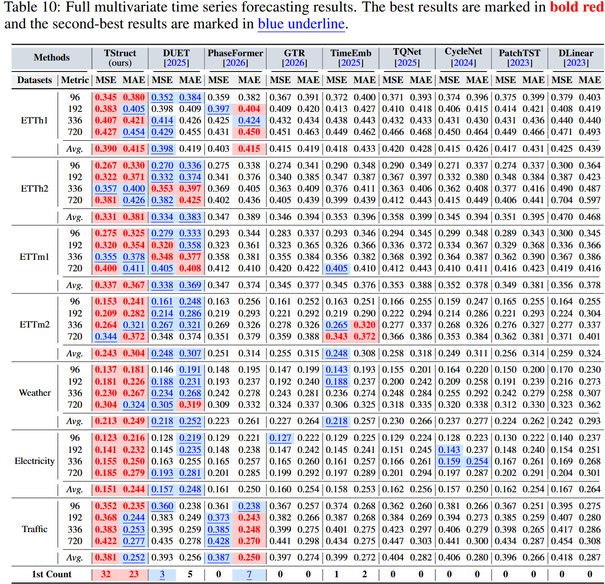

# TStruct: Learning Shared Temporal Structures for Long-Term Time Series Forecasting (NeurIPS 2026)

[OpenReview](https://openreview.net/forum?id=q3fXT85cph) · [arXiv](https://arxiv.org/abs/2610.17864)

## Motivation


**When observations are difficult to align, could the temporal relationships needed for forecasting be easier to reuse?**

Time series from different systems differ in scale, meaning, and statistical properties, while distribution shifts make these properties change over time. These challenges motivate a fundamental question: what knowledge should a forecasting model share across samples, variables, and potentially domains? We hypothesize that heterogeneous observations can reflect recurring modes of temporal evolution, and that the relationships relevant to prediction may vary within a more compact space than the observations themselves.

In attention-based models, temporal dependencies are typically computed as dot products between query and key vectors derived from the input at different time positions. TStruct takes a different approach: **learn reusable temporal dependency patterns directly, and let input content determine how to combine them.** This makes shared relational structure an explicit modeling target while retaining the ability to adapt to each sample and variable.

To investigate this hypothesis, we construct patch-level temporal relationship matrices and analyze their spectral properties across samples and variables. Spectral concentration in the stacked, vectorized matrices suggests that their dominant patterns can be described by a small number of shared directions. We further evaluate two null controls through the same analysis pipeline. Real data exhibit stronger concentration than independent Gaussian inputs. Concentration also decreases when patch positions are independently shuffled, preserving each relationship matrix's spectrum while disrupting the correspondence of relative temporal positions across matrices. Together, these observations support the presence of reusable temporal relationship patterns at aligned relative positions.

Building on this insight, **TStruct directly parameterizes a set of shared temporal dependency structures and adaptively combines them using dynamic sample information and static variable priors.** Shared structures capture reusable patterns, while their combinations accommodate heterogeneous inputs for long-term forecasting. This work studies structural reuse across samples and variables, and motivates a broader direction: pretraining a dictionary of temporal relationships that different forecasting tasks can select, combine, and adapt to their own observations.

<p align="center">
  <a href="figures/motivation.png"></a>
</p>

## Method

TStruct learns a set of shared temporal dependency matrices. Dynamic sample information and static variable priors determine how these matrices are combined, and the resulting scores are normalized with softmax to aggregate patch-level features. A parameter-efficient channel adaptation head then maps these features to future predictions.

<p align="center">
  <a href="figures/methodology.png"></a>
</p>

## Time Structure Visualizations

We provide additional visualizations of the learned temporal structures across all benchmark datasets. Red and blue indicate higher and lower relative aggregation preferences, respectively. The visualizations show that the learned structures are not random mixing patterns.

<details open>
<summary><strong>ETTh1</strong></summary>

<p align="center">
  <a href="figures/ETTh1.png"></a>
</p>

</details>

<details open>
<summary><strong>ETTh2</strong></summary>

<p align="center">
  <a href="figures/ETTh2.png"></a>
</p>

</details>

<details open>
<summary><strong>ETTm1</strong></summary>

<p align="center">
  <a href="figures/ETTm1.png"></a>
</p>

</details>

<details open>
<summary><strong>ETTm2</strong></summary>

<p align="center">
  <a href="figures/ETTm2.png"></a>
</p>

</details>

<details open>
<summary><strong>Weather</strong></summary>

<p align="center">
  <a href="figures/Weather.png"></a>
</p>

</details>

<details open>
<summary><strong>Electricity</strong></summary>

<p align="center">
  <a href="figures/Electricity.png"></a>
</p>

</details>

<details open>
<summary><strong>Traffic</strong></summary>

<p align="center">
  <a href="figures/Traffic.png"></a>
</p>

</details>

## Results

<p align="center">
  <a href="figures/results.png"></a>
</p>

## Getting Started

### 1. Prepare the Datasets

We provide training and evaluation scripts for the following public datasets:

**ETTh1, ETTh2, ETTm1, ETTm2, Weather, Electricity, and Traffic.**

📥 Download from [Google Drive](https://drive.google.com/file/d/1ypgCc6iQ2Z8IB_9CY3If_KMRNQKBsI3J/view?usp=sharing).

Create a `datasets` directory in the project root:

```bash
mkdir -p datasets
```

Extract the downloaded files and arrange the CSV files as follows:

```text
TStruct-main/
├── datasets/
    ├── ETTh1.csv
    ├── ETTh2.csv
    ├── ETTm1.csv
    ├── ETTm2.csv
    ├── weather.csv
    ├── electricity.csv
    ├── traffic.csv
    └── your_dataset.csv
```

### 2. Run the Experiments

Run the following command from the project root to train and evaluate TStruct on ETTh1:

```bash
bash scripts/TStruct/etth1.sh
```

Scripts for the other datasets are available in `scripts/TStruct/`:

```bash
bash scripts/TStruct/etth2.sh
bash scripts/TStruct/ettm1.sh
bash scripts/TStruct/ettm2.sh
bash scripts/TStruct/weather.sh
bash scripts/TStruct/electricity.sh
bash scripts/TStruct/traffic.sh
```

After creating and configuring your custom dataset script, run:

```bash
bash scripts/TStruct/your_dataset.sh
```

Evaluation results are appended to `result.txt`.

## Citation

If you find this work helpful, please consider citing it:

```bibtex
@inproceedings{lyz2026tstruct,
  title={{TS}truct: Learning Shared Temporal Structures for Long-Term Time-Series Forecasting},
  author={Yangze Li and Zhengyang Zhou and Qihe Huang and Pengkun Wang and Binwu Wang and Yang Wang},
  booktitle={The Fortieth Annual Conference on Neural Information Processing Systems},
  year={2026},
  url={https://openreview.net/forum?id=q3fXT85cph}
}
```

## Acknowledgements

We would like to thank the authors of the following open-source projects for their valuable contributions, which have provided significant help for our work:

- [LTSF-Linear](https://github.com/cure-lab/LTSF-Linear)
- [OpenTS](https://decisionintelligence.github.io/OpenTS/)


## Contact

We welcome questions, feedback, and discussions! Feel free to contact us at [liyangze@mail.ustc.edu.cn](mailto:liyangze@mail.ustc.edu.cn) or [submit an issue](https://github.com/yangzeli/TStruct/issues).


