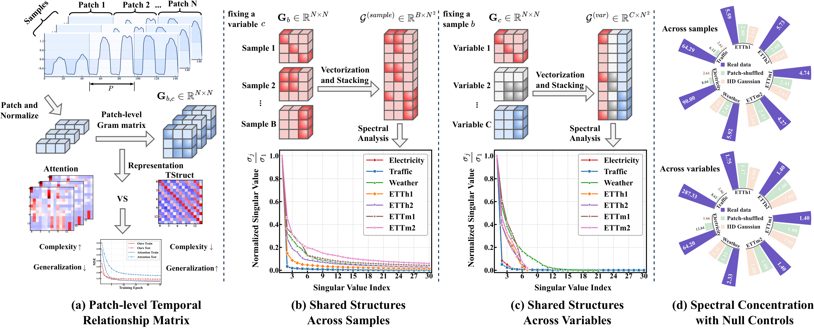
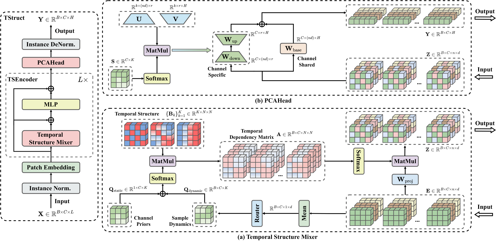
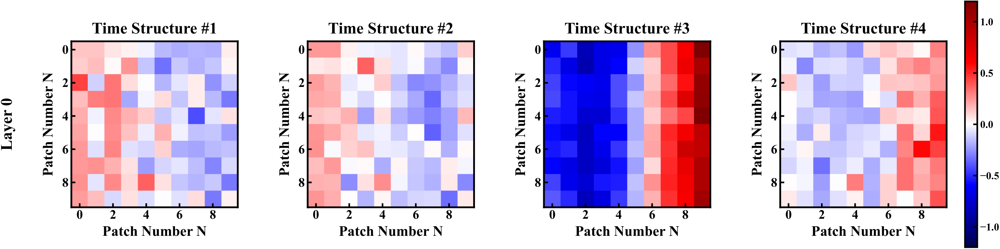
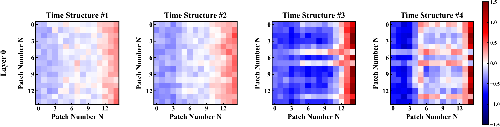
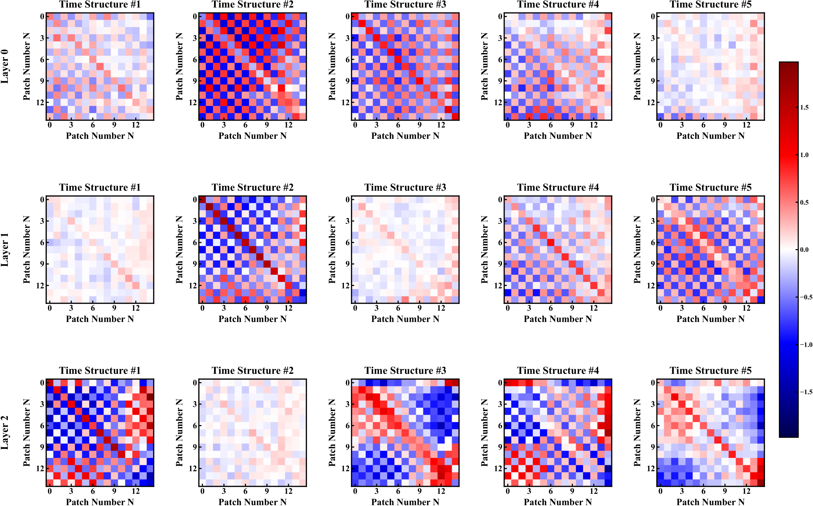
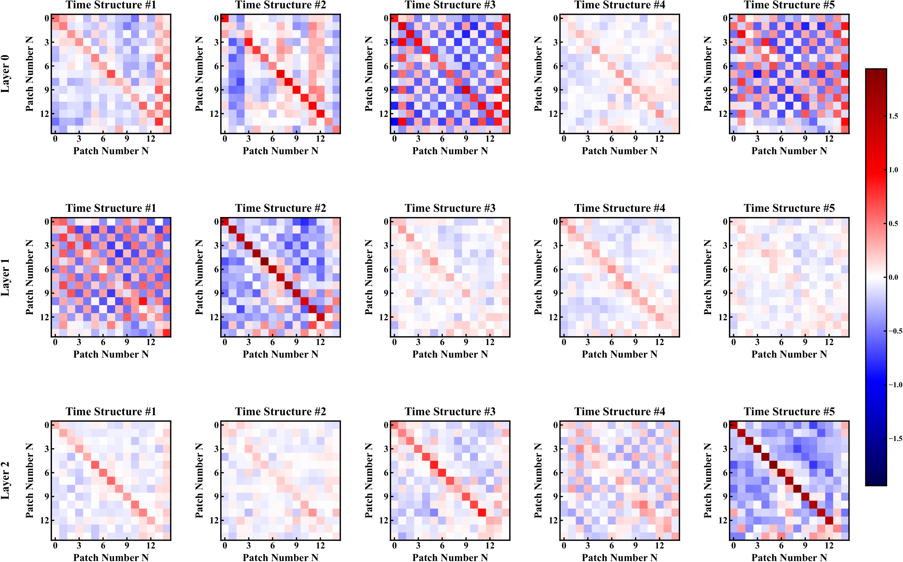
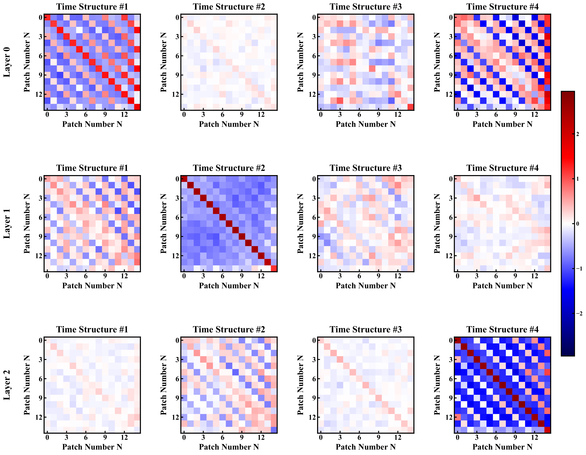
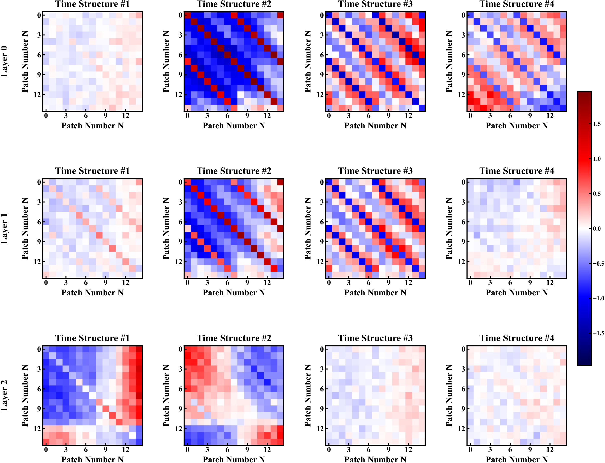
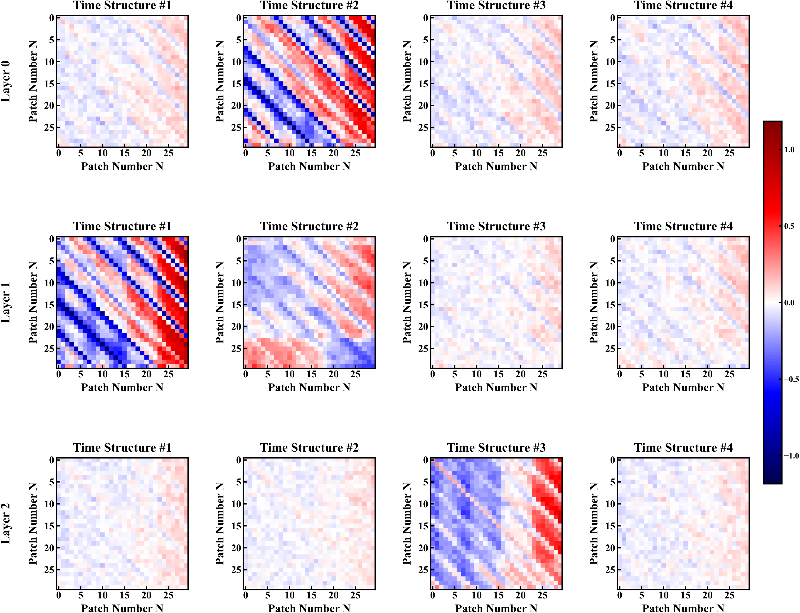

# TStruct: Learning Shared Temporal Structures for Long-Term Time-Series Forecasting. (NeurIPS 2026)

[Openreview](https://openreview.net/forum?id=q3fXT85cph) · [arXiv](https://arxiv.org/abs/2610.17864)

## Motivation

Shared temporal structures exist across samples and variables in time series. TStruct aims to learn and reuse these structures for long-term forecasting.

<p align="center">
  <a href="figures/motivation.png"></a>
</p>

## Method

TStruct combines a shared temporal structure basis with channel- and instance-dependent coefficients to model temporal dependencies. A parameter-efficient channel adaptation head maps the resulting representations to future predictions.

<p align="center">
  <a href="figures/methodology.png"></a>
</p>

## Time Structure Visualizations

The heatmaps below visualize the learned temporal structure matrices on seven datasets. Both axes index temporal patches; each panel shows one structure, with rows corresponding to encoder layers where applicable. Click a figure to view it at full resolution.

<details open>
<summary><strong>ETTh1</strong></summary>

<p align="center">
  <a href="figures/ETTh1.png"></a>
</p>

</details>

<details>
<summary><strong>ETTh2</strong></summary>

<p align="center">
  <a href="figures/ETTh2.png"></a>
</p>

</details>

<details>
<summary><strong>ETTm1</strong></summary>

<p align="center">
  <a href="figures/ETTm1.png"></a>
</p>

</details>

<details>
<summary><strong>ETTm2</strong></summary>

<p align="center">
  <a href="figures/ETTm2.png"></a>
</p>

</details>

<details>
<summary><strong>Weather</strong></summary>

<p align="center">
  <a href="figures/Weather.png"></a>
</p>

</details>

<details>
<summary><strong>Electricity</strong></summary>

<p align="center">
  <a href="figures/Electricity.png"></a>
</p>

</details>

<details>
<summary><strong>Traffic</strong></summary>

<p align="center">
  <a href="figures/Traffic.png"></a>
</p>

</details>

## Getting Started

### 1. Prepare the Datasets

We provide training and evaluation scripts for the following public datasets:

**ETTh1, ETTh2, ETTm1, ETTm2, Weather, Electricity, and Traffic.**

📥 Download from [Google Drive](https://drive.google.com/file/d/1ypgCc6iQ2Z8IB_9CY3If_KMRNQKBsI3J/view?usp=sharing).

Create a `datasets` directory in the project root:

```bash
mkdir -p datasets
```

Extract the downloaded files and arrange the CSV files as follows:

```text
TStruct-main/
├── datasets/
    ├── ETTh1.csv
    ├── ETTh2.csv
    ├── ETTm1.csv
    ├── ETTm2.csv
    ├── weather.csv
    ├── electricity.csv
    ├── traffic.csv
    └── your_dataset.csv
```

### 2. Run the Experiments

Run the following command from the project root to train and evaluate TStruct on ETTh1:

```bash
bash scripts/TStruct/etth1.sh
```

Scripts for the other datasets are available in `scripts/TStruct/`:

```bash
bash scripts/TStruct/etth2.sh
bash scripts/TStruct/ettm1.sh
bash scripts/TStruct/ettm2.sh
bash scripts/TStruct/weather.sh
bash scripts/TStruct/electricity.sh
bash scripts/TStruct/traffic.sh
```

After creating and configuring your custom dataset script, run:

```bash
bash scripts/TStruct/your_dataset.sh
```

Evaluation results are appended to `result.txt`.

## Citation

If you find this work helpful, please consider citing it:

```bibtex
@inproceedings{lyz2026tstruct,
  title={{TS}truct: Learning Shared Temporal Structures for Long-Term Time-Series Forecasting},
  author={Yangze Li and Zhengyang Zhou and Qihe Huang and Pengkun Wang and Binwu Wang and Yang Wang},
  booktitle={The Fortieth Annual Conference on Neural Information Processing Systems},
  year={2026},
  url={https://openreview.net/forum?id=q3fXT85cph}
}
```

## Acknowledgements

We would like to thank the authors of the following open-source projects for their valuable contributions, which have provided significant help for our work:

- [LTSF-Linear](https://github.com/cure-lab/LTSF-Linear)
- [OpenTS](https://decisionintelligence.github.io/OpenTS/)


